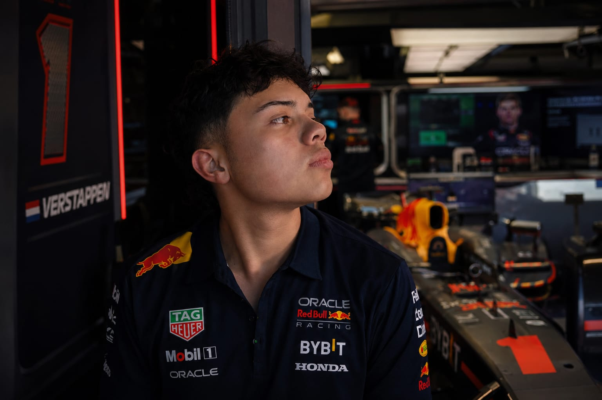

## ADSO 3410390



## Juan José Bernal Montes

### Análisis y Desarrollo de Software

**Centro de Procesos Industriales y Construcción**

> SENA - Regional Caldas

---

## 📋 Descripción del proyecto

Sitio web / portafolio de fases para el proyecto **"PIT STOP CAFÉ BAR"** — cafetería de especialidad con temática de motorsport (Fórmula 1).

Cada fase del proyecto se desarrolla como una entrega estática en HTML/CSS/JS vanilla:

| Fase | Contenido |
|---|---|
| 01 — Layout | Organización, distribución y composición de la interfaz. |
| 02 — Wireframe LO-FI | Boceto estructural (recorrido y organización de elementos). |
| 02 — Wireframe HI-FI | Wireframe de alta fidelidad. |
| 03 — Style Guide | Criterios y elementos visuales de la marca. |
| 04 — Mockup | Representación visual estática de la interfaz final. |
| 05 — Code | Implementación funcional (HTML/CSS/JS) del PIT STOP CAFÉ BAR. |

---

## 🚀 Cómo previsualizar localmente

```bash
# desde la raíz del repositorio
python3 -m http.server 8080
```

Luego abrir: <http://localhost:8080>

---

## 📁 Estructura del repositorio

```
/
├── index.html                  # Landing con el menú de fases
├── src/
│   ├── css/master.css          # Hoja maestra: tokens, reset, utilidades base
│   └── imgs/                    # Imágenes del portafolio
└── 01-layout/
    ├── index.html              # Hub de fases
    ├── wireframeLOFI.html
    ├── wireframeHIFI.html
    ├── stylesGuide.html
    ├── mockup.html
    └── code/                    # Fase implementada
        ├── code.html
        ├── src/
        │   ├── css/style.css
        │   ├── js/script.js
        │   └── imgs/
        └── ...
```

---

## ✅ Estado de calidad

- HTML validable en lo esencial, con `skip link`, foco visible y navegación por teclado.
- Contador (`countdown`) y cronómetro del hero con soporte de `aria-live`.
- Menú móvil con `aria-expanded`, cierre por `Escape`, click fuera y **focus trap** (Tab cíclico).
- Barra de progreso de carrera con `role="progressbar"` y valores ARIA.
- Animaciones respetando `prefers-reduced-motion`.

---

## 🔭 Próximos pasos sugeridos

- Optimización de imágenes (WebP/AVIF + `srcset`).
- Consolidar breakpoints y estilos duplicados en CSS.
- Corregir frame de Figma del mockup (verificar en Figma el node correcto).
- Agregar pruebas automatizadas / Lighthouse.

---

## Créditos

**Juan José Bernal Montes** — Análisis y Desarrollo de Software  
Centro de Procesos Industriales y Construcción — SENA Regional Caldas
